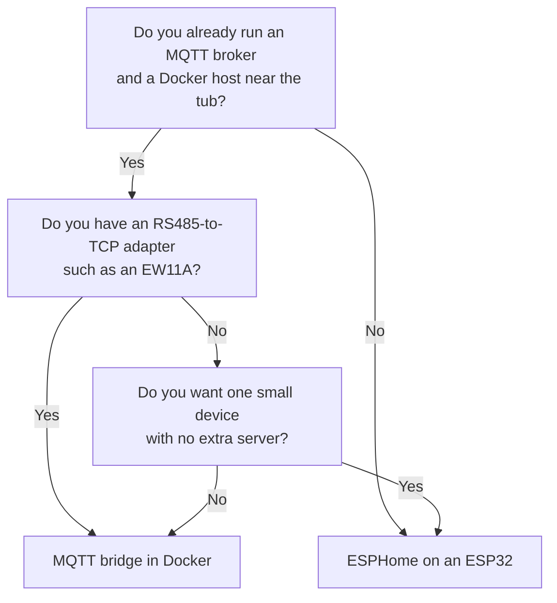

# Getting started

This page helps you choose how to run spa2mqtt and shows a safe first run. The first run
only reads the bus. It proves that your wiring and your tub definition work before
anything can send a command to the tub.

## 1. Choose how to run it



**MQTT bridge (Docker).** Choose this if you already have an RS485-to-TCP adapter, such
as the EW11A, wired to the tub. The bridge is easy to update and to debug, because it
runs as a normal container and logs to the console. It needs an MQTT broker, for example
the Mosquitto add-on in Home Assistant.

**ESPHome.** Choose this if you want one small device in the tub cabinet and no extra
server. The ESP32 decodes the bus itself and talks to Home Assistant over the ESPHome
native API. You do not need an MQTT broker. See [ESPHome](esphome/index.md).

You can start with one and move to the other later. Both use the same tub definitions
and the same entity names. See [Switch over from MQTT](esphome/migrate.md).

## 2. What you need

For both options:

- A supported tub. Today that is the Jacuzzi J235 (`jacuzzi_j235`). Other tubs need a
  [tub definition](tub-definitions.md).
- Access to the RS485 header on the spa control board. The header is intended for a
  second topside panel. It carries the RS485 A and B lines that the topside panel uses.
- A way to isolate the spa from mains power while you wire it. See [Safety](safety.md).

For the MQTT bridge:

- An RS485-to-TCP adapter (for example the Elfin EW11A) set to 115200 baud, 8 data bits,
  no parity, 1 stop bit (8N1), in TCP server mode. spa2mqtt connects to it on port 8899 by
  default. A USB RS485 adapter also works if the container runs next to the tub.
- A host that runs Docker, with Docker Compose or Portainer.
- An MQTT broker that Home Assistant uses, with MQTT discovery enabled (the default).

For ESPHome:

- An ESP32 board with an RS485 transceiver. The example uses a Waveshare
  ESP32-S3-ETH-8DI-8RO. See [Hardware and wiring](esphome/hardware.md).

## 3. First run: read-only monitor

`spa2mqtt monitor` decodes the live bus and prints it to your terminal. It does not
connect to MQTT and it cannot transmit. Three separate guards stop it from writing: the
tub model runs receive-only, the monitor has no bus writer, and the connection is wrapped
so that any write raises an error. Use it to check the wiring and the decoded values
before you install anything else.

!!! warning "One client at a time"
    Many RS485-to-TCP adapters, the EW11A included, accept only one TCP client. Stop any
    other program that connects to the adapter first. An old v1 bridge must be stopped in
    any case, because v1 transmits at start-up.

=== "Docker (no install)"

    Docker runs the published image once and removes the container when you press Ctrl-C.
    Replace the address with your adapter's address.

    ```bash
    docker run --rm -it ghcr.io/srleach/spa2mqtt:2 spa2mqtt monitor 192.168.1.100
    ```

=== "Python"

    spa2mqtt needs Python 3.11 or later. A virtual environment keeps its packages apart
    from the rest of your system.

    ```bash
    python3 -m venv .venv && . .venv/bin/activate
    pip install "spa2mqtt @ git+https://github.com/srleach/spa2mqtt@v2.0.0"
    spa2mqtt monitor 192.168.1.100
    ```

    Replace `v2.0.0` with the newest release tag. See [Releases and versions](releases.md).
    For a USB RS485 adapter, install `spa2mqtt[serial]` and use `--serial /dev/ttyUSB0`.

You get a full report at once, and then one every 10 seconds. Between reports, the
monitor prints each value change and each topside button press as it happens.

Check these points against the topside panel:

1. The water temperature matches the display.
2. The clock (hour and minute) matches the topside clock.
3. A pump or light press at the topside shows up as a change.
4. The checksum error count stays at or near zero. A high count usually means a wrong
   baud rate or swapped A and B wires.

If all four are correct, the definition fits your tub. Continue with
[Docker Compose](install/docker-compose.md), [Portainer](install/portainer.md) or
[ESPHome](esphome/index.md). If they are wrong, see
[Monitor and capture](monitor-and-capture.md) and record a capture.

## 4. Next steps

- Leave transmit off for the first days. Watch the values in Home Assistant and compare
  them with the topside.
- Enable transmit only when the values are right. See [Safety](safety.md) and
  [Configuration](configuration.md#transmit).
- Pin a release so that updates happen when you choose. See
  [Releases and versions](releases.md).
