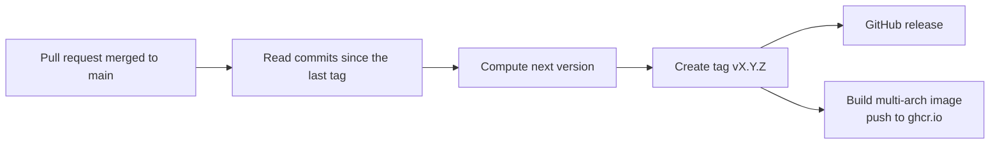

# Releases and versions

spa2mqtt uses semantic versioning (semver). A version has three numbers, `MAJOR.MINOR.PATCH`:

- **MAJOR** goes up for a breaking change. You may need to change your setup when you
  upgrade.
- **MINOR** goes up for a new feature that does not break anything.
- **PATCH** goes up for a fix or any other change.

The first release is `v2.0.0`. Version 1 was the earlier implementation, kept on the
`legacy/pre-rewrite` branch.

## How a release happens

Every merge to the `main` branch makes a release automatically. You do not need to tag by
hand, and every change on `main` gets a version that you can pin. A maintainer can still
push a `vX.Y.Z` tag by hand. The workflow then publishes that tag and creates no new one.



The release workflow reads the commit messages since the newest `vX.Y.Z` tag. It uses the
[Conventional Commits](https://www.conventionalcommits.org/) style to choose the bump:

| Commit message | Bump | Example |
|---|---|---|
| `type!:` or `type(scope)!:`, or a body line that starts with `BREAKING CHANGE` | Major | `feat!: rename the transmit setting` |
| `feat:` or `feat(scope):` | Minor | `feat(esphome): add a light entity` |
| Anything else (`fix:`, `docs:`, `chore:`, no type) | Patch | `fix: reconnect after adapter reboot` |

The largest bump in the range wins. For example, one `feat:` and three `fix:` commits give
a minor release.

To merge without a release, put `[skip release]` in the pull request title, or in the
message of the commit that lands on `main`. Use this
for changes that do not affect users, for example a CI tweak. The next release then
includes those commits.

## Where releases appear

- **Tags**: `vX.Y.Z` in the repository.
- **GitHub releases**: [github.com/srleach/spa2mqtt/releases](https://github.com/srleach/spa2mqtt/releases),
  with release notes.
- **Container images**: [ghcr.io/srleach/spa2mqtt](https://github.com/srleach/spa2mqtt/pkgs/container/spa2mqtt).

## Image tags

Each release pushes one image, built for `linux/amd64`, `linux/arm64` and `linux/arm/v7`,
under several tags. For release `2.3.1`:

| Tag | Moves to | Use it when |
|---|---|---|
| `2.3.1` | Never moves | You want exactly this build. Best for rollback |
| `2.3` | Each new `2.3.x` patch | You want fixes only |
| `2` | Each new `2.x.y` release | You want fixes and features, without breaking changes. The default in the deploy files |
| `latest` | Each new release, majors included | Not recommended for a tub. A major release can need changes |
| `sha-<short>` | Never moves | You need the image for one exact commit |

To change the tag, set `SPA2MQTT_TAG` in `.env` (Docker Compose) or in the stack's
environment variables (Portainer). See [Docker Compose](install/docker-compose.md#roll-back)
and [Portainer](install/portainer.md#roll-back-or-pin-a-version).

## Pin ESPHome to a release

ESPHome downloads the component and the entity package from GitHub at compile time. Pin
both to the same release tag, so a later change on `main` cannot change your device the
next time you compile:

```yaml
external_components:
  - source: github://srleach/spa2mqtt@v2.0.0
    components: [spa_bus]

packages:
  spa_entities: github://srleach/spa2mqtt/esphome/packages/jacuzzi_j235.yaml@v2.0.0
```

Use a full `vX.Y.Z` tag. ESPHome resolves a git reference, and only full version tags exist.
To upgrade, change both tags, then compile and install again. See
[Build and flash](esphome/install.md).

## Documentation site

This site is built with [MkDocs Material](https://squidfunk.github.io/mkdocs-material/).
The workflow `.github/workflows/docs.yml` does two jobs:

- On every pull request, it builds the site with `mkdocs build --strict`. A broken internal
  link or a missing page fails the check.
- On every push to `main`, it builds the site again and publishes it to the `gh-pages`
  branch.

The site appears at <https://seanrleach.co.uk/spa2mqtt/> once GitHub Pages is on. The
repository owner enables it once:

1. Open the repository on GitHub and select **Settings > Pages**.
2. Under **Build and deployment**, set **Source** to **Deploy from a branch**.
3. Set **Branch** to `gh-pages` and the folder to `/ (root)`, then select **Save**.

The `gh-pages` branch exists after the first push to `main` that runs the docs workflow.
GitHub Pages on a private repository needs a paid plan, so the site may only work after the
repository is public.

## Container image visibility

GitHub Container Registry (GHCR) makes a new package private when the first image is
pushed. A private package needs a login to pull, so `docker pull` fails for other users.
After the repository is public, the owner makes the package public once:

1. Open the repository on GitHub and select the `spa2mqtt` package under **Packages**.
2. Select **Package settings**.
3. Under **Danger Zone**, select **Change visibility**, then **Public**.

To preview the site on your computer:

```bash
python3 -m venv .venv-docs && . .venv-docs/bin/activate
pip install -r requirements-docs.txt
mkdocs serve
```

Then open <http://127.0.0.1:8000/>. The page reloads when you save a file.
