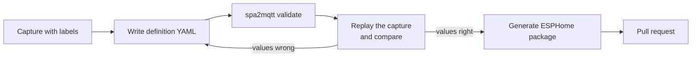

# Tub definitions

A *tub definition* is a YAML file that describes one tub model. It says how to decode the
status frames, which buttons exist, and which entities Home Assistant gets. The Python
bridge reads it at start-up. The ESPHome component reads it at compile time and turns it
into C++ tables. Because both read the same file, both give the same entities.

Built-in definitions live in
[`definitions/`](https://github.com/srleach/spa2mqtt/tree/main/definitions). List them
with:

```bash
spa2mqtt definitions
```

A new tub that uses the same protocol family (`balboa_encrypted`) needs only a new YAML
file, with no Python or C++. A tub with a different framing or cipher needs a new codec
in `spa2mqtt/protocol/` and in `esphome/components/spa_bus/spa_protocol.cpp`.

## Add a tub



1. **Capture.** Record the bus with `tools/capture.py` while you press each topside button,
   and type a label before each press. See [Monitor and capture](monitor-and-capture.md).
2. **Copy a definition.** Start from
   [`definitions/jacuzzi_j235.yaml`](https://github.com/srleach/spa2mqtt/blob/main/definitions/jacuzzi_j235.yaml).
   Give the copy a new `id` and file name.
3. **Edit the field map, buttons and entities.** The sections below explain each part.
4. **Validate.** `spa2mqtt validate` checks every definition against the schema and the
   loader's own checks. Give a path to check only your file:

    ```bash
    spa2mqtt validate definitions/my_tub.yaml
    ```

5. **Replay and compare.** Decode your capture with your definition, and compare the
   values with what the topside showed at each label:

    ```bash
    spa2mqtt monitor --replay my-capture.log -d definitions/my_tub.yaml --describe
    ```

6. **Add tests.** Put the capture in `tests/fixtures/captures/raw/` and add the expected
   values to `tests/test_replay.py`. The tests then guard your definition from future
   changes.
7. **Generate the ESPHome package.** This writes `esphome/packages/<id>.yaml` with every
   entity of the definition:

    ```bash
    python3 tools/gen_esphome_package.py
    ```

    CI runs `python3 tools/gen_esphome_package.py --check` and fails if a package is out of
    date. Never edit a generated package by hand.

8. **Open a pull request.**

You can also use a definition file without adding it to the repository. Set
`spa.definition` (or `SPA_DEFINITION`) to the file path for the bridge, or set
`definition:` to the path in the ESPHome `spa_bus:` block.

## Schema

The schema is
[`definitions/tub-definition.schema.json`](https://github.com/srleach/spa2mqtt/blob/main/definitions/tub-definition.schema.json)
(JSON Schema draft 2020-12). It documents every key. The loader adds checks that a schema
cannot express: referenced fields and buttons exist, byte offsets fit in the payload, and
keys are unique.

### Top level

| Key | Meaning |
|---|---|
| `schema_version` | Always `1` |
| `id` | Lower-case identifier, for example `jacuzzi_j235`. Used in config and in topics |
| `aliases` | Other names that also select this definition |
| `name`, `manufacturer`, `model`, `description` | Shown in Home Assistant and in logs |
| `protocol` | Codec family in code. Today only `balboa_encrypted` |
| `temperature_unit` | `C` or `F` |
| `bus` | Bus settings: `baud`, `client_mid`, `channel_request_magic`, `dormant_channel_threshold`. The last three are used only when transmit is on |
| `status` | How to decode the status frame. See [Decode modes](#decode-modes) |
| `commands` | Button frame type, encoding (`cc_xor`) and the code of each button |
| `fields` | The field map. See [Fields](#fields) |
| `entities` | What Home Assistant gets. See [Entities](#entities) |

### Decode modes

`status.decode` selects how the bridge turns a raw status frame into plain bytes. The
encrypted boards hide the status payload with a per-frame key and a fixed key stream. See
the [wire protocol](protocol.md) for the details.

| Mode | What it does | Use it when |
|---|---|---|
| `decrypt` | Removes the per-frame key and the key stream. Every field then reads as plain bytes | You know the key stream. This is the current J235 decode |
| `unkey` | Removes only the per-frame key | You are still working out the key stream |
| `fold` | The older pairwise reading of the payload | You have only old fold-based notes or logs |

`status.length` is the decoded length: 33 for `decrypt` and `unkey` on the J235, 16 for
`fold`.

### Keystream

`decrypt` needs `status.keystream`. Byte `i` of the key stream (for `i >= 1`) is:

```text
S[i] = xor ^ ((start - i + adjust[i]) mod 64)
```

`xor` and `start` are numbers. `adjust` is an optional map from byte index to a small
correction. The J235 uses `{xor: 0x19, start: 31, adjust: {"5": -8, "14": -8, "15": -8, "22": -8}}`.
The corrections were calibrated against the wall clock and the topside readings.

### Fields

Each field reads a value from the decoded payload:

```yaml
fields:
  water_temperature: {byte: 10, scale: 0.5, status: confirmed, evidence: "protocol.md §5 d5"}
  heater:            {byte: 21, bit: 6, status: confirmed}
  pump_1_speed:      {byte: 5, shift: 3, mask: 0x03, map: {"0": "off", "1": "low", "2": "high"}, status: confirmed}
```

The bridge and the ESPHome component apply the same steps, in this order:

1. Read `length` bytes (default 1) from `byte` as a big-endian number.
2. XOR the number with `xor` (default 0).
3. If `bit` is set, the value is that bit, as on or off. Stop.
4. Shift right by `shift` (default 0) and apply `mask` (default all ones).
5. If the result is in `invalid`, the value is unknown.
6. If `map` is set, the value is the mapped text. An unknown number gives an unknown value.
7. Otherwise the value is `raw * scale + offset` (defaults 1 and 0).

Every field needs a `status`: `confirmed`, `inferred` or `hypothesis`. Add `evidence` to
say where the claim comes from. The monitor shows the status next to each value, and the
bridge logs entities that rest on a hypothesis.

### Entities

Each entity maps a field or a button to a Home Assistant entity.

| `component` | Needs | Notes |
|---|---|---|
| `sensor` | `field` | Optional `device_class`, `unit_of_measurement`, `state_class`, `accuracy_decimals` |
| `binary_sensor` | `field` | Optional `device_class` |
| `text_sensor` | `field` | For mapped values such as pump speed |
| `button` | `press` | A button name from `commands.buttons` |
| `number` | `field`, `control`, `min`, `max`, `step` | Setpoint. `control` names the up and down buttons |

Every entity has a `key`, a `component` and a `name`. Optional: `icon` (`mdi:...`),
`entity_category` (`diagnostic` or `config`), `enabled_by_default`, `description`.

!!! warning "Keys and names are identities"
    The `key` becomes the Home Assistant `unique_id`. With legacy topics on, the `name` is
    part of the discovery topic. Changing either one for an existing tub creates a new
    entity in Home Assistant and leaves the old one behind.

## Test a new definition safely

Keep transmit off while you test a new or changed definition. A wrong field map only shows
wrong values. A wrong button code or bus setting with transmit on could send a command
that you did not intend. See [Safety](safety.md).
