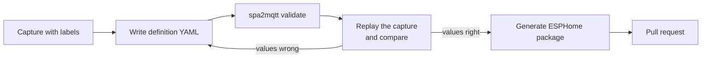

# Tub definitions

A *tub definition* is a YAML file that describes one tub model. It says how to decode the
status frames, which buttons exist, and which entities Home Assistant gets. The Python
bridge reads it at start-up. The ESPHome component reads it at compile time and turns it
into C++ tables. Because both read the same file, both give the same entities.

Built-in definitions live in
[`definitions/`](https://github.com/srleach/spa2mqtt/tree/main/definitions). List them
with:

```bash
spa2mqtt definitions
```

A new tub that uses an existing protocol family needs only a new YAML file, with no Python
or C++. A tub with a different framing or cipher needs a new codec in `spa2mqtt/protocol/`
and in `esphome/components/spa_bus/spa_protocol.cpp`.

| `protocol` | Boards | Runs on | Reference |
|---|---|---|---|
| `balboa_encrypted` | Encrypted Jacuzzi and Sundance boards (0xC4 status), for example the J235 | MQTT bridge and ESPHome | [Wire protocol](protocol.md) |
| `jacuzzi_plain` | Unencrypted Jacuzzi boards (0x16 status) behind a ProLink module, for example the J345 | MQTT bridge only | [Wire protocol (plain boards)](protocol-plain.md) |

## Add a tub



1. **Capture.** Record the bus with `tools/capture.py` while you press each topside button,
   and type a label before each press. See [Monitor and capture](monitor-and-capture.md).
2. **Copy a definition.** Start from
   [`definitions/jacuzzi_j235.yaml`](https://github.com/srleach/spa2mqtt/blob/main/definitions/jacuzzi_j235.yaml).
   Give the copy a new `id` and file name.
3. **Edit the field map, buttons and entities.** The sections below explain each part.
4. **Validate.** `spa2mqtt validate` checks every definition against the schema and the
   loader's own checks. Give a path to check only your file:

    ```bash
    spa2mqtt validate definitions/my_tub.yaml
    ```

5. **Replay and compare.** Decode your capture with your definition, and compare the
   values with what the topside showed at each label:

    ```bash
    spa2mqtt monitor --replay my-capture.log -d definitions/my_tub.yaml --describe
    ```

6. **Add tests.** Put the capture in `tests/fixtures/captures/raw/` and add the expected
   values to `tests/test_replay.py`. The tests then guard your definition from future
   changes. `raw/` is for `balboa_encrypted` tubs: every capture there is also decoded by
   the C++ core with the J235 definition. Captures of other families go in their own
   folder, as the J345's do in `tests/fixtures/captures/unencrypted/`.
7. **Generate the ESPHome package.** This writes `esphome/packages/<id>.yaml` with every
   entity of the definition:

    ```bash
    python3 tools/gen_esphome_package.py
    ```

    CI runs `python3 tools/gen_esphome_package.py --check` and fails if a package is out of
    date. Never edit a generated package by hand. The tool skips `jacuzzi_plain`
    definitions, because the ESPHome component does not implement that family.

8. **Open a pull request.**

You can also use a definition file without adding it to the repository. Set
`spa.definition` (or `SPA_DEFINITION`) to the file path for the bridge, or set
`definition:` to the path in the ESPHome `spa_bus:` block.

## Schema

The schema is
[`definitions/tub-definition.schema.json`](https://github.com/srleach/spa2mqtt/blob/main/definitions/tub-definition.schema.json)
(JSON Schema draft 2020-12). It documents every key. The loader adds checks that a schema
cannot express: referenced fields and buttons exist, byte offsets fit in the payload, and
keys are unique.

### Top level

| Key | Meaning |
|---|---|
| `schema_version` | Always `1` |
| `id` | Lower-case identifier, for example `jacuzzi_j235`. Used in config and in topics |
| `aliases` | Other names that also select this definition |
| `name`, `manufacturer`, `model`, `description` | Shown in Home Assistant and in logs |
| `protocol` | Codec family in code: `balboa_encrypted` or `jacuzzi_plain` |
| `temperature_unit` | `C` or `F`. An entity with `device_class: temperature` must use the same unit |
| `ha` | Optional. `device_name` and `device_identifier` for Home Assistant, used when `config.yml` sets neither. Defaults: `name` and `id` |
| `bus` | Bus settings: `baud`, `client_mid`, `channel_request_magic`, `dormant_channel_threshold`. The last three are used only when transmit is on. See also [Direct bus mode](#direct-bus-mode) |
| `status` | How to decode the status frame. See [Decode modes](#decode-modes) |
| `extra_frames` | Further periodic frames that fields may read. See [Extra frames](#extra-frames) |
| `commands` | Button frame type, encoding (`cc_xor` or `plain`), the code of each button, and [direct commands](#direct-commands) |
| `fields` | The field map. See [Fields](#fields) |
| `entities` | What Home Assistant gets. See [Entities](#entities) |

### Decode modes

`status.decode` selects how the bridge turns a raw status frame into plain bytes. The
encrypted boards hide the status payload with a per-frame key and a fixed key stream. See
the [wire protocol](protocol.md) for the details.

| Mode | What it does | Use it when |
|---|---|---|
| `decrypt` | Removes the per-frame key and the key stream. Every field then reads as plain bytes | You know the key stream. This is the current J235 decode |
| `unkey` | Removes only the per-frame key | You are still working out the key stream |
| `fold` | The older pairwise reading of the payload | You have only old fold-based notes or logs |
| `plain` | Nothing. The payload is already plain bytes | The board is unencrypted (`protocol: jacuzzi_plain`). The loader rejects it for any other family |

`status.length` is the decoded length: 33 for `decrypt` and `unkey` on the J235, 16 for
`fold`.

### Keystream

`decrypt` needs `status.keystream`. Byte `i` of the key stream (for `i >= 1`) is:

```text
S[i] = xor ^ ((start - i + adjust[i]) mod 64)
```

`xor` and `start` are numbers. `adjust` is an optional map from byte index to a small
correction. The J235 uses `{xor: 0x19, start: 31, adjust: {"5": -8, "14": -8, "15": -8, "22": -8}}`.
The corrections were calibrated against the wall clock and the topside readings.

### Fields

Each field reads a value from the decoded payload:

```yaml
fields:
  water_temperature: {byte: 10, scale: 0.5, status: confirmed, evidence: "protocol.md §5 d5"}
  heater:            {byte: 21, bit: 6, status: confirmed}
  pump_1_speed:      {byte: 5, shift: 3, mask: 0x03, map: {"0": "off", "1": "low", "2": "high"}, status: confirmed}
```

The bridge and the ESPHome component apply the same steps, in this order:

1. Read `length` bytes (default 1) from `byte` as a big-endian number.
2. XOR the number with `xor` (default 0).
3. If `bit` is set, the value is that bit, as on or off. Stop.
4. Shift right by `shift` (default 0) and apply `mask` (default all ones).
5. If the result is in `invalid`, the value is unknown.
6. If `map` is set, the value is the mapped text. An unknown number gives an unknown value.
7. Otherwise the value is `raw * scale + offset` (defaults 1 and 0).

Every field needs a `status`: `confirmed`, `inferred` or `hypothesis`. Add `evidence` to
say where the claim comes from. The monitor shows the status next to each value, and the
bridge logs entities that rest on a hypothesis.

### Extra frames

A plain board sends its light state in a second periodic frame. `extra_frames` names such
a frame, and a field selects it with `frame`:

```yaml
extra_frames:
  lights: {type: 0x23, length: 28}
fields:
  light_brightness: {frame: lights, byte: 2, status: confirmed, evidence: "S L63->L64"}
```

A field without `frame` reads the status frame. The loader checks the byte offset against
the length of the frame the field names. Values from an extra frame merge into the same
state as the status values.

On an encrypted board (`balboa_encrypted`) an extra frame is keyed, so it needs
`decode: fold`. Fields then index the folded payload, `d[j] = p[2j] ^ p[2j+1] ^ 1`, which is
`length // 2` bytes long. The J235 lights frame:

```yaml
extra_frames:
  lights: {type: 0xCA, length: 29, decode: fold}
fields:
  light_on: {frame: lights, byte: 1, bit: 6, status: confirmed, evidence: "D7 t~294 on, 307 off"}
```

`decode: plain` (the default) is for `jacuzzi_plain` only. The ESPHome component decodes the
status frame only: its package leaves out entities that read an extra frame.

### Buttons and direct commands

`commands.buttons` maps a button name to its one-byte code. The short form is the code
alone. The long form adds a status and evidence, and is the form to use for a tub that
nobody on the project can test:

```yaml
commands:
  type: 0x17
  encode: plain
  buttons:
    pump_1: {code: 0x04, status: confirmed, evidence: "S L22->L23 on, L24->L25 off"}
```

#### Direct commands

`commands.direct` (`jacuzzi_plain` only) names commands that have their own frame type.
The payload is a list of bytes. At most one item may be the word `value`, and then `min`
and `max` give the allowed range of that byte:

```yaml
  direct:
    set_temperature: {type: 0x20, payload: [value], min: 80, max: 104, status: confirmed, evidence: "S L8->L9"}
    light_red:       {type: 0x21, payload: [0x1F, 0x06, 0, 0, 0, 0, 0xFF, 0], status: confirmed, evidence: "S L38->L39"}
```

A `button` entity may `press` a direct command that has no `value`. A `number` entity uses
one that has a `value` (see [Entities](#entities)). The bridge refuses to build a frame
with a value outside `min`..`max`. Every direct command needs a `status`.

`requires` is an optional guard. It maps status bit fields to the value each must have in
the last decoded status frame. If one differs, or no status frame has been decoded yet,
the bridge refuses the command. The J345 uses `requires: {celsius_mode: false}` on
`set_temperature`, because the byte it sends is only known to mean whole degrees
Fahrenheit.

### Direct bus mode

`bus.mode` selects how the bridge gets its turn to send.

| `bus.mode` | Behaviour | Use it when |
|---|---|---|
| `claim` (default) | Wait for the board's clear-to-send on a claimed channel ([wire protocol §4](protocol.md)) | The bridge is on the RS485 bus itself (EW11A, USB adapter) |
| `direct` | Send from the fixed `bus.client_address`, one frame per `bus.send_gap_frames` status frames (default 4). No channel claim | A module such as the ProLink arbitrates the bus (`jacuzzi_plain` only) |

`bus.hello` names a direct command that the bridge sends once per connection, just before
the first queued command. Leave it out to send no such frame. The loader requires
`commands.encode: plain` and `bus.mode: direct` together.

### Entities

Each entity maps a field or a button to a Home Assistant entity.

| `component` | Needs | Notes |
|---|---|---|
| `sensor` | `field` | Optional `device_class`, `unit_of_measurement`, `state_class`, `accuracy_decimals` |
| `binary_sensor` | `field` | Optional `device_class` |
| `text_sensor` | `field` | For mapped values such as pump speed. Home Assistant shows it as a sensor with a text value |
| `button` | `press` | A button name from `commands.buttons`, or a direct command with no `value` |
| `switch` | `field`, `press` | An on/off state that a toggle button changes. `field` is a bit field. Optional `off_field`, `confirm_frames`, `max_presses`, `progress_field`, `device_class`. Bridge only |
| `number` | `field`, `control`, `min`, `max`, `step` | `control: {type: stepper, up:, down:}` presses the up and down buttons until the field matches. `control: {type: direct, command:}` sends one direct command with the value |

A `direct` number needs a one-byte field with no `scale`, `offset`, `xor`, `shift` or
`mask`, whole-number `min`, `max` and `step`, and a range inside the command's `min`..`max`.
The value sent is then the value shown. A value outside `min`..`max` is refused, not
clamped: one message becomes one frame, with no stepping.

A `switch` presses its button only while `field` differs from the state that Home Assistant
asked for. After each press it waits `confirm_frames` status frames (default 10, about
three seconds on a J235) for the field to follow, then presses again. It stops after
`max_presses` (default 3) and logs a warning. The wait matters: a second press sent too
early turns a two-state pump straight back.

Some pumps cycle off, low, high, off, so "off" from low takes two presses and the field
stays on in between. Name the speed field as `progress_field`. A change there shows that
the press arrived, and the next press follows without the wait.

A switch for one speed of such a pump reads that speed's bit, but its "off" should be the
pump fully off, not the next speed. Name the "running at any speed" bit as `off_field`:
"off" is then reached when that field reads false. The J235 *Pump 1 Low* switch reads
`pump_1_low` and has `off_field: pump_1_running`, so turning it off from low steps through
high to off.

With `bus.mode: direct` a switch sends one frame and never retries, so `max_presses` must
be `1` (the default there).

The ESPHome component has no switch platform yet. The generated package leaves switches
out.

Every entity has a `key`, a `component` and a `name`. Optional: `icon` (`mdi:...`),
`entity_category` (`diagnostic` or `config`), `enabled_by_default`, `description`.

!!! warning "Keys and names are identities"
    The `key` becomes the Home Assistant `unique_id`. With legacy topics on, the `name` is
    part of the discovery topic. Changing either one for an existing tub creates a new
    entity in Home Assistant and leaves the old one behind.

## Test a new definition safely

Keep transmit off while you test a new or changed definition. A wrong field map only shows
wrong values. A wrong button code or bus setting with transmit on could send a command
that you did not intend. See [Safety](safety.md).
